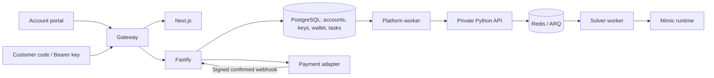

# Operations and integrations

## One Huggin stack

The parent Huggin repository owns Compose, secrets, and ingress. This repository
provides Docker targets `web` (Next.js standalone) and `platform` (Fastify API or
the separate PostgreSQL task worker). From the parent checkout, after placing the
Linux amd64 Mimic binary in `bin/mimic`:

```sh
git submodule update --init --recursive
python scripts/configure_deployment.py
docker compose up --build -d
```

The initializer preserves credentials and generates only missing
`POSTGRES_PASSWORD` and `SOLVER_SECRET`. One production build runs locally and
behind Cloudflare; there are no separate Compose profiles. Standalone watchers
remain available for development.



Only gateway publishes a host port, normally `127.0.0.1:3000`. Platform, ingress,
and solver networks isolate traffic. PostgreSQL, Redis, Python API, and CDP are
private. Browser requests use relative `/api` URLs; customers use `/api/v1` with
their own keys, never the solver secret.

## Configuration and Cloudflare

Configure the parent `.env`:

| Variable                                    | Meaning / default                                             |
| ------------------------------------------- | ------------------------------------------------------------- |
| `APP_ORIGIN`                                | Exact external origin; `http://localhost:3000` locally        |
| `HTTP_BIND`, `HTTP_PORT`                    | Gateway address; `127.0.0.1`, `3000`                          |
| `POSTGRES_PASSWORD`                         | Persistent database credential, generated by initializer      |
| `SOLVER_URL`, `SOLVER_SECRET`               | Private endpoint (`http://api:8000`) and shared secret        |
| `HCAPTCHA_WORKER_CONCURRENCY`               | Platform and solver concurrency; `5`                          |
| `TASK_TIMEOUT_SECONDS`                      | Deadline from first processing claim; `300`                   |
| `TASK_PRICE_MICRO_USD`                      | Per-task reservation; `2000` = USD 0.002                      |
| `PLATFORM_API_UPSTREAM`, `WEBSITE_UPSTREAM` | Runtime gateway destinations; `platform-api:4000`, `web:3000` |
| `EDGE_TRUSTED_PROXY_CIDRS`                  | Trusted connector/proxy addresses; none by default            |
| `HCAPTCHA_DIAGNOSTICS`                      | Private task/phase logs; `0`                                  |
| `PAYMENT_PROVIDER`                          | `disabled` until a real adapter is configured                 |

Compose supplies the database URL, `NODE_ENV=production`, `DEMO_MODE=false`, and
`SOLVER_PROVIDER=mimic`. Model credentials belong only to private solver workers.
`TRUSTED_PROXIES` restricts the platform's proxy trust; standalone defaults trust
loopback, and Compose configures internal ingress ranges.

For Cloudflare Tunnel forward the domain to `http://127.0.0.1:3000`; a Docker
connector can join the parent ingress network and use `http://gateway:80`.
Set `APP_ORIGIN=https://your-domain.example` and recreate platform services.
That origin enables Secure, \_\_Host-, HttpOnly, SameSite=Lax session cookies even
with an internal HTTP hop. Configure `EDGE_TRUSTED_PROXY_CIDRS` for the actual
connector addresses before trusting CF-Connecting-IP. Gateway replaces forwarded
IP headers. Exclude `/api/*` and `/app/*` from cache rules. Tunnel/domain setup is
external; a DNS-proxy deployment requires origin TLS for Full (strict), while
the bundled gateway serves local HTTP.

Gateway addresses are runtime settings. Direct Next.js servers use
`API_INTERNAL_URL` in a build-time rewrite. Docker sets `API_PROXY_ENABLED=false`
because gateway owns routing.

## Customer API and accounts

Base: `https://your-domain.example/api/v1` (local: `http://localhost:3000/api/v1`).
Send `Authorization: Bearer hg_live_…`:

| Method | Path         | Purpose                                                                                        |
| ------ | ------------ | ---------------------------------------------------------------------------------------------- |
| GET    | `/balance`   | USD balance as a decimal string                                                                |
| POST   | `/tasks`     | Submit `{ "type": "hcaptcha", "websiteURL": "https://example.com", "websiteKey": "site-key" }` |
| GET    | `/tasks/:id` | Owned task status and result                                                                   |

Creation returns HTTP 202. An account-scoped `Idempotency-Key` returns the same
task for identical input; different input returns 409. The public contract
accepts those three fields only. Private options such as proxies, cookies,
invisible mode, and Enterprise context are not exposed here.

Statuses: `queued`, `processing`, `succeeded`, `failed`. Success includes
`result.token` and nullable `serverAcceptance`, `userAgent`, `respKey`.
Acceptance is observed solver evidence, not proof that a customer's application
accepted the token. Cleanup nulls token/userAgent/respKey, retaining history.

Account endpoints under `/api` use sessions: `/auth/register`, `/auth/login`,
`/auth/logout`, `/account`, `/account/password`, `/stats`, `/tasks`, `/keys`,
`/billing`, `/billing/checkout`. Browser mutations validate Origin; Bearer
requests do not need a browser Origin. New accounts start at zero. Passwords
accept 8–128 characters and use salted scrypt. Sessions last seven days by
default. Password changes revoke all sessions and establish a new current one.
API secrets appear once; only SHA-256 hashes are stored, with 20 active keys
maximum per account. Lists use 20 entries per page. Statistics use UTC days in
7/30/90-day windows; display timezone changes only table timestamps.

## Wallet and task recovery

Amounts use integer microdollars (`1 USD = 1000000`). Creation reserves the
configured task price atomically with the task and ledger. Token delivery settles
the reservation; failure/timeout refunds once. Customer charges are per task;
the private model cost/token ledger is separate from the wallet.

Workers atomically claim queued/expired tasks with SKIP LOCKED. A 30-second lease
renews every 10 seconds. Shutdown releases it without refund; another worker
resumes the same solver UUID and original processing deadline. Fenced completion
blocks stale workers. Redis terminal publication is atomic. Unfinished browser
or model work may repeat after a crash; exactly-once external execution is not
promised. Late results cannot reopen terminal tasks or change wallet settlement.

## Private solver adapters

`server/providers.ts` defines SolverEngine and PaymentProvider. This repository
contains transport adapters, not the private solver engine.

Compose uses `SOLVER_PROVIDER=mimic`, an internal HTTP(S) `SOLVER_URL`, and
`SOLVER_SECRET` of at least 32 characters. The Bearer-authenticated adapter uses:

- `PUT /internal/tasks/:uuid` with
  `{ "task": { "type": "HCaptchaTaskProxyless", "websiteURL": "...", "websiteKey": "..." } }`.
- `GET /internal/tasks/:uuid` polls using the same UUID.
- Identical dispatch is idempotent; conflicting input returns 409.
- Transient/lost acknowledgments retry the same ID; terminal errors or the
  remaining processing deadline cause failure/refund.

Legacy Python `/createTask` and `/getTaskResult` are also private; `clientKey`
is not customer authentication. Do not publish that port.

For a separate synchronous adapter, `SOLVER_PROVIDER=http` sends a Bearer POST
to `SOLVER_URL` with `{ taskId, websiteURL, websiteKey }` and expects
`{ "token": "..." }`. The provider must deduplicate taskId for crash recovery.
Production configuration requires HTTPS for this generic adapter.
Standalone defaults disable solver integration.

## Payment adapter and future crypto funding

Wallet accounting, pending checkout records, and signed confirmation are
implemented. A specific crypto processor, chains, exchange-rate policy,
confirmation thresholds, and withdrawals are not. A future adapter must verify
the payment and produce the exact expected USD credit. Underpayment, overpayment,
expiry, fees, and chain confirmation policy belong to that integration.

Set `PAYMENT_PROVIDER=http`, `PAYMENT_URL`, `PAYMENT_SECRET`, and an independent
`PAYMENT_WEBHOOK_SECRET` of at least 32 characters. Bearer-authenticated checkout:

```json
{
  "paymentId": "uuid",
  "amountMicro": "10000000",
  "currency": "USD",
  "returnURL": "https://your-domain.example/app/billing"
}
```

Response: `{ "reference": "provider-reference", "checkoutURL": "https://provider.example/checkout/..." }`.
Checkout requires HTTPS; UI amounts are whole USD from 5 to 10000. Pending
checkout does not change balance. The disabled default returns 503 without credit.

After verification POST exact JSON bytes to `/api/webhooks/payment`:

```json
{
  "paymentId": "uuid",
  "reference": "provider-reference",
  "amountMicro": "10000000",
  "currency": "USD",
  "status": "confirmed"
}
```

`X-Huginn-Timestamp`: Unix seconds. `X-Huginn-Signature`: hex HMAC-SHA256 of
`timestamp + "." + rawBody` using PAYMENT_WEBHOOK_SECRET. The five-minute window
requires a fresh signature for retries. ID, reference, amount, currency must
match the stored payment. Retry temporary failures, including notifications
arriving before checkout reference storage. Concurrent/replayed confirmations
credit once. Browser redirects never credit funds. Real crypto integration is
pending; test confirmations are isolated fixtures only.

## Storage, retention, and updates

Parent volumes: `postgres-data` for accounts/wallet/tasks, `redis-data` for ARQ
with AOF, `solver-data` for contracts/statistics/budget/raw evidence.
`docker compose down` preserves them; adding `-v` deletes them.
Host `runs/` evidence is separate and is not automatically imported.

Use consistent PostgreSQL pg_dump/pg_restore backups. Back up private .env and
solver ledgers/evidence too. Snapshot Redis consistently or stop writers before
copying its volume. Test restoration into isolated storage. Changing
POSTGRES_PASSWORD in .env does not rotate an existing database password; update
the database user and configuration together.

The platform periodically clears expired sessions and result token/userAgent/
respKey older than 24 hours. Task/ledger history remains. Private Redis results
also default to 24 hours. Raw solver statistics evidence defaults to 90 days,
cleaned on subsequent solve/statistics operations. Raw captures may contain
sensitive payloads/tokens; portal cleanup does not delete that evidence.
Explicit replay/run directories have a separate lifecycle.

Update a tested parent revision with its pinned website commit:

```sh
git pull --ff-only
git submodule update --init --recursive
docker compose up --build -d
docker compose ps
docker compose logs --tail 100 gateway platform-api platform-worker api worker
```

Publish website changes first, then record the new gitlink in the parent.
Do not automatically upgrade deployments with `git submodule update --remote`.
Migrations run before platform services; rollback must account for schema
compatibility and queued tasks. Recreate both platform-worker and worker after
changing shared concurrency.

Gateway `/healthz` checks the platform API/database, not real solving or payment
acceptance. Python health checks Redis and reports workers. Use Compose status
and private task evidence for diagnosis.

## Standalone development and checks

Requires Node.js 22.21+:

```sh
npm ci
cp .env.example .env
npm run db:generate
npm run db:local
```

Windows: `Copy-Item .env.example .env`. Embedded PostgreSQL uses
127.0.0.1:54329 and ignored .local/postgres. Leave it running; in another terminal
run `npm run db:migrate` then `npm run dev`. Web/API/worker have separate watchers.
This helper is not the Docker deployment database. For an existing database set
DATABASE_URL and skip db:local.

Optional samples require non-production NODE_ENV, DEMO_MODE=true, and local
DEMO_PASSWORD of at least eight characters, then `npm run db:seed`. The marked
demo@huginn.local account has synthetic records, not production credits or
working keys/tokens. Production rejects demo mode.

```sh
npm test
npm run typecheck
npm run build
npm run test:integration
```

Integration tests require DATABASE_URL and schema privileges; TEST_DATABASE_URL
can select another server. Runner migrates/removes a unique temporary schema
and refuses NODE_ENV=production. Fixtures cover 7-character rejection/8-character
acceptance, account isolation, keys, last-balance idempotency, renewable leases,
timeout/refund fencing, stats, and signed payment replay. They do not prove live
solving or payments. The parent README explains optional real Redis/ARQ fixture
tests using TEST_SOLVER_URL and TEST_SOLVER_SECRET.

Fastify uses Helmet, 64 KB body limits, validation, sanitized errors, and memory
rate limits: 120/minute/IP, authentication 10/15 minutes, checkout 10/minute.
Multiple API replicas need a shared rate-limit store. Email verification/recovery,
withdrawals, and crypto handling remain operator work. Publish real operator
identity, privacy contacts, retention and refund/withdrawal terms before
commercial launch. Public copy is customer facing, not a deployment-status page.
